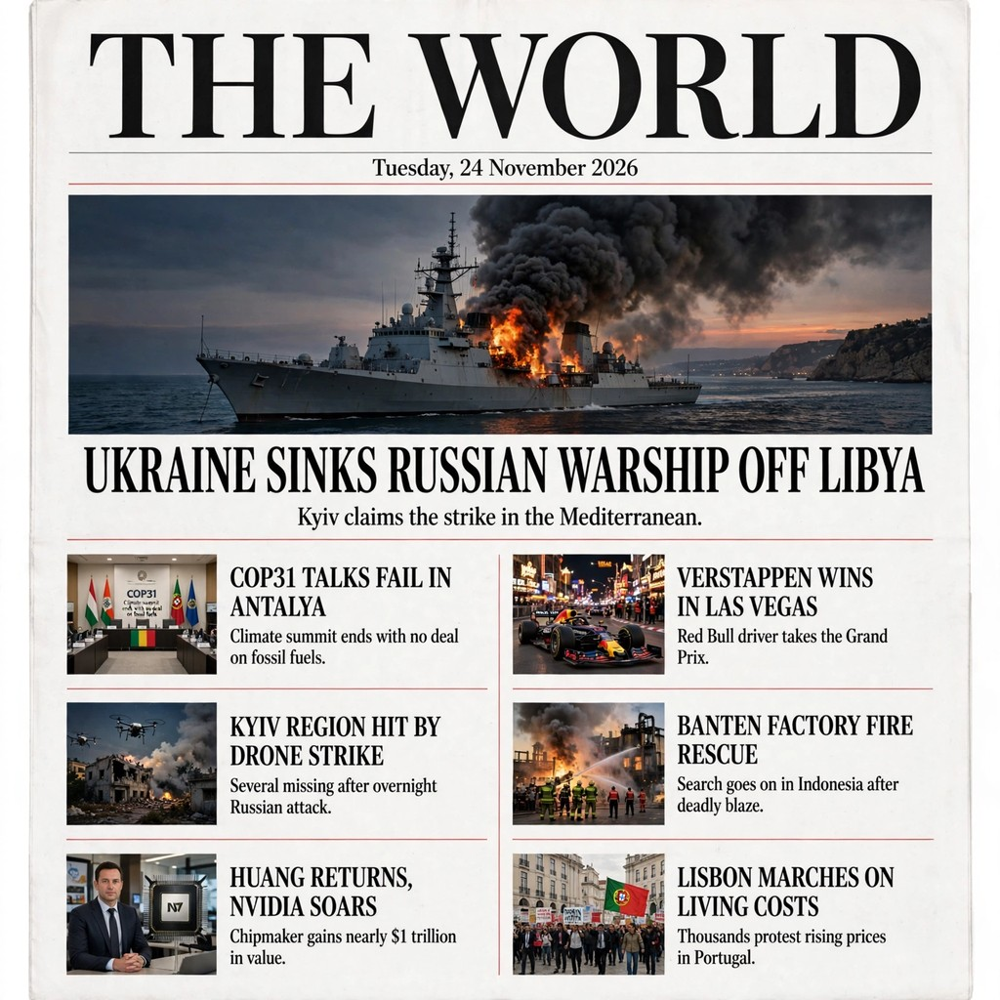

# THE WORLD — Tuesday, 24 November 2026

[](https://make.fun/bounty/news-image-20261124)
[](https://make.fun/bounty/news-image-20261124)
[](https://make.fun/bounty/news-image-20261124)

One image summing up the world's news of Tuesday, 24 November 2026 — an entry
for the [make.fun bounty](https://make.fun/bounty/news-image-20261124)
"Sum up 24 November's world news in one image".



## The seven stories

1. **WAR AT SEA — Ukraine sinks Russian warship off Libya.** Kyiv claims the
   strike on the corvette Merkury in the Mediterranean, and a Russian cargo
   ship also catches fire off Finland after a reported attack.
2. **CLIMATE — COP31 talks fail in Antalya.** The climate summit in Türkiye
   ends with no deal as countries stay divided over fossil fuels.
3. **UKRAINE — Kyiv region hit by drone strike.** Several people are missing
   after an overnight Russian drone attack, President Zelenskyy says.
4. **TECH — Huang returns, Nvidia soars.** Jensen Huang is back at Nvidia and
   the chipmaker gains nearly $1 trillion in value as tech stocks rally.
5. **SPORT — Verstappen wins in Las Vegas.** The Red Bull driver takes the
   Las Vegas Grand Prix.
6. **INDONESIA — Banten factory fire rescue.** Search and rescue go on after
   the deadly blaze at a factory in Banten province.
7. **PORTUGAL — Lisbon marches on living costs.** Thousands take to the
   streets to protest rising prices.

## How it runs

`main.ts` (Node 22, standard library only) copies `entry.png` to
`/output/entry.png`. The image is 1024 × 1024 and was made for this entry in
the build session; the program runs twice and writes the same bytes both
times.

Run it locally:

```sh
mkdir -p out && MAKEFUN_OUTPUT_DIR=out node main.ts
```

## Sources

- Naval News / Ukrainian claims on the warship off Libya
- BBC on the COP31 talks in Antalya
- Ukrainian presidency on the Kyiv-region drone strike
- Market reporting on Nvidia's rally after Huang's return
- Formula 1 reporting on the Las Vegas Grand Prix
- Indonesian reporting on the Banten factory fire
- Portuguese reporting on the Lisbon cost-of-living march
